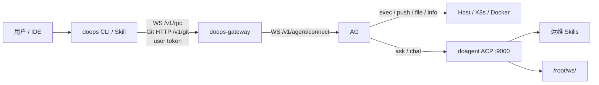

# doops.sh

`doops` 是 SSH 的替代入口。日常使用只走公网 `doops-gateway`，再由 gateway 路由到主动注册的内网 `doops-agent`；不需要 SSH 用户、SSH 端口或 SSH 密码。

## GitHub 发布说明

本仓库的公开发布分支使用脱敏配置：文档和测试中的公网地址、镜像仓库、模型网关和凭据均使用示例占位。真实 gateway token、API key、registry 密码、SSH 凭据和 kubeconfig 必须通过环境变量、Kubernetes Secret 或本机忽略配置提供，不能提交到 git。

标准验证命令：

```bash
(cd agent && go test ./...)
(cd gateway && go test ./...)
(cd cli && go test ./...)
```

## 架构图

自然语言发布的权威职责边界见
[docs/NATURAL_LANGUAGE_DEPLOYMENT.md](docs/NATURAL_LANGUAGE_DEPLOYMENT.md)。DoOps 不实现另一套
Agent 框架；上下文、规划、多 Agent、Skill 和工具调用由 doagent 原生引擎负责。



系统里有两条正交维度：

- 连接模式：CLI/skill 连接 gateway，内网 agent 主动注册 gateway
- 执行模式：快路径 `exec/read/write/push/pull/info/check/clean`，慢路径 `ask` / 后续 `chat`

组件分工：

- 客户端：`doops` CLI + doops skill
- 公网控制面：`gateway/` 构建 `doops-gateway`，负责 RBAC、审计、排队和内网 agent 路由
- 边缘执行端：`agent/` 构建 `doops-agent`，负责目标机器上的 exec、push/pull、文件和 AI 任务
- 运行安全边界：`doops-agent` 默认只启动 `doops-agent`、`do-agent`、`buildkitd`；默认不启动 `sshd`，不启动 WebIDE
- 连接方式：CLI/skill 访问 gateway `42222`，gateway 通过已建立的 agent WebSocket 进入内网 agent
- 用户用 Gateway user token 操作目标。Agent 用 `cluster/instance` 注册，已启用 enrollment 的目标还需提供对应的 enrollment token。
- 代码同步：`push/pull` 默认使用 COS 快照。显式选择 `--storage gateway` 时，Gateway 通过 Agent 的反向隧道转发 Git HTTP 请求，同步当前工作区。
- 镜像构建与操作：统一使用 `buildctl + buildkitd` 构建、`skopeo` 做 OCI copy/inspect；Agent 镜像内置这两套命令。

## Target 口径

target 只来自本机 Gateway-only `config.json` 与 Gateway 当前在线注册状态。仓库文档不维护
环境 target 清单，也不根据业务名、IP、历史 cluster 或旧节点别名生成 target。

## 当前镜像与协议

当前维护版 agent 默认采用轻量双镜像发布。镜像由操作方以显式 registry/repository/tag 构建并推送，
本仓库不含镜像发布流水线；不带标签的 `docker pull` 使用 `latest`，它只表示最近一次推送的构建，
固定版本仍使用完整 commit SHA、发布标签或 digest。

```bash
docker pull registry.example.com/doops-agent
docker pull registry.example.com/doops-web
```

```text
registry.example.com/doops-agent:latest                 # 最近一次推送构建的 Agent 镜像，等同于不写标签
registry.example.com/doops-web:latest                   # 最近一次推送构建的 Web 控制台镜像
registry.example.com/doops-agent/base-light:<release>   # 基础工具：buildkit / kubectl / Python+PyYAML / Helm / git / ssh client / tini / bash
registry.example.com/doops-agent:<release>              # doops-agent / 精确 doagent / skills / docs / entrypoint
```

`Dockerfile` 不提供可用的可变基础镜像默认值；缺参数会立即失败。构建时必须显式传入本次不可变的
`DOOPS_AGENT_BASE_IMAGE` 和 `DO_AGENT_IMAGE`；`DO_AGENT_VERSION` 等版本基线从 `runtime-versions.env`
读取并在构建时校验，当前运行架构固定为 `linux/amd64`。

```text
Dockerfile.base.light                     # 轻量基础镜像：doagent / buildkit / kubectl / Python+PyYAML / Helm / git / ssh client / tini / bash
registry.example.com/doops-agent/base-light:<release>
registry.example.com/doops-agent:<release>
```

`base-light` 的目标是作为纯 `doops-agent` 运行时，不再默认继承 WebIDE 启动器或
SSH 服务端。镜像保留 `ssh` 客户端，已在线 Agent 可通过结构化 `doops ssh` 代理执行
用户明确给出的 SSH 命令；它不会启动 `sshd`，也不会恢复 SSH target 或直连入口。
多层 SSH 不得拼入 `doops exec` 字符串。

镜像构成：

- 基础镜像源码：`Dockerfile.base.light`
- doAgent 版本基线：`runtime-versions.env`
- 更新镜像源码：`Dockerfile`
- doagent 来源：最终镜像从显式传入的 `DO_AGENT_IMAGE` 复制，不依赖基础镜像内的历史二进制；
  `runtime-versions.env` 保留版本与 digest 元数据用于校验
- DoOps 只有一个发布版本：CLI、Gateway 和 Agent 统一嵌入同一个发布标签，并同时报告
  本次构建的完整 40 位源提交作为不可变 provenance；已安装 CLI 和目标 Agent
  可处于不同版本。Agent 自身升级的版本验收见 [构建与部署 SOP](docs/BUILD_DEPLOY_SOP.md)
- `DO_AGENT_VERSION` / `DO_AGENT_REVISION` 只记录内置 doagent 依赖 provenance，不是
  DoOps 发布版本；`cli-contract/v3` 只通过 `doops --contract` 暴露为协议兼容性检查，
  不进入正常版本输出
- 网关二进制：`/app/doops-agent`
- doagent AI 内核：`/usr/local/bin/do-agent`
- 构建闸门：独立 `DO_AGENT_IMAGE` 和最终镜像必须确认 `/usr/local/bin/do-agent --version` 与声明的 `DO_AGENT_VERSION` 完全一致；基础镜像只负责 BuildKit、kubectl、Python/PyYAML、Helm 等工具，并固定到 OCI digest
- 发布原则：最终镜像同时固定 `DOOPS_AGENT_BASE_IMAGE` 和 `DO_AGENT_IMAGE`；app 镜像 push 前必须校验两者 label、`/app/doops-agent -help`、`/usr/local/bin/do-agent --version` 与声明版本一致、`buildctl --version`、Python/PyYAML 与 Helm。普通业务 Helm 发布见 [业务发布契约](docs/NATURAL_LANGUAGE_DEPLOYMENT.md)。

协议与端点：

- CLI 到 gateway 使用 `WS /v1/rpc?cluster=<cluster>&instance=<instance>`
- 内网 agent 到 gateway 使用 `WS /v1/agent/connect?cluster=<cluster>&instance=<instance>`
- 公网网站代理使用请求 `Host` 匹配 Gateway 路由表，再通过同一条 Agent 反向
  WebSocket 转发 HTTP/HTTPS；路由管理入口为 `/v1/admin/proxy-routes`
- 模型网关地址使用 `https://api.example.com` / `https://api.example.com/v1`，不带 `:8443`

本轮维护已清理的技术债：

- 将 doagent 依赖镜像固定为公开 doAgent 的版本标签和 OCI digest，并在每层镜像中校验二进制版本
- 将 agent 发布拆为基础镜像 `<registry>/<repository>/base-light:<release>` 和 `<registry>/<repository>:<release>`，避免每次代码更新都拉取多 GiB 基础层
- 统一发布脚本与 DaemonSet 使用受控构建产出的不可变镜像 digest
- 关闭默认攻击面：`agent-entrypoint.sh` 改为仅在显式 `DOOPS_ENABLE_SSHD=1` / `DOOPS_ENABLE_WEBIDE=1` 时才启动 SSH 或 WebIDE
- 标准运行镜像保留出站 SSH 客户端，但不安装或启动 SSH 服务端
- 将 doagent 旧叙述收敛为当前 doagent ACP HTTP 路径
- 新增多用户多集群 `doops-gateway`：SQLite、user token、用户对 `cluster/instance` 的目标授权、审计和 Git HTTP 反向隧道
- 统一 `push/pull`：gateway 使用 Git 快照语义，并按 `/v1/git/<cluster>/<instance>/<session>.git` 精确路由到目标 agent
- 加固多人使用：user token 按 token id 单行校验，密码登录 token 默认 24 小时过期，同一 target 默认有界排队串行执行
- `doops upgrade` 通过集群内 Job 升级标准 Helm Agent；只有 `--dry-run` 是参数预览，Agent 进程不能直接替换自身工作负载

## Gateway 代码入口

`doops-gateway` 是一等组件，源码入口在仓库一级目录：

```bash
bash scripts/build-gateway.sh
./bin/doops-gateway serve -db /var/lib/doops-gateway/gateway.db -port 42222
```

`gateway/` 只是构建入口，实现在 `agent/internal/server/`，与 Agent 运行时共用一个包，文件索引见
[agent/internal/server/README.md](agent/internal/server/README.md)。

面向外部系统的 API 使用指南见 [docs/DOOPS_API_GUIDE.md](docs/DOOPS_API_GUIDE.md)，包括登录、目标查询、WebSocket JSON-RPC、自然语言部署、进度流和审计查询。

## Agent 双镜像构建

本仓库不含镜像发布流水线。操作方使用 `scripts/build-agent-base-image.sh`、
`scripts/build-agent-image.sh` 构建并推送两类镜像；脚本要求显式给出
`DOOPS_IMAGE_REGISTRY`、`DOOPS_IMAGE_REPOSITORY`、`DOOPS_SOURCE_COMMIT`（完整 40 位）
和 `DOOPS_IMAGE_TAG`（基础镜像脚本用 `DOOPS_BASE_RELEASE_TAG`），并显式传入已固定 digest 的
`DO_AGENT_IMAGE`、`DOOPS_AGENT_BASE_IMAGE`；缺任一输入立即失败：

```text
registry.example.com/doops-agent/base-light:<release>
registry.example.com/doops-agent:<release>
```

分层边界：

- `doops-agent/base-light`：doagent、BuildKit、kubectl、系统包、通用运行工具；变化频率低，拉取成本高。
- `doops-agent`：`/app/doops-agent`、`/app/skills`、`/app/self-docs`、entrypoint；变化频率高，拉取成本低。

禁止把基础 rootfs 压平成每次 release 都变化的大层。操作方可以推送 release tag
供制品发现，但线上升级必须把选中的 `doops-agent` 解析并固定为 OCI digest；节点仍可
复用已缓存的基础层，同时避免 tag 漂移造成不可复现发布。

基础镜像必须作为独立 repository 发布（例如 `<registry>/<repository>/base-light`）；
不要把它做成 Agent repository 的某种别名。

## 固定路径

- CLI：`~/.local/bin/doops`
- Skill 源码权威位置：`skills/SKILL.md`
- Skill 安装目标：当前项目、全局 `.agent/skills/doops/` 及已启用的 Codex/Agents 副本，见[安装指南](docs/CLUSTER_INSTALL_GUIDE.md)
- CLI 唯一默认配置：`~/.agent/skills/doops/config.json`
- Gateway 登录态：`~/.agent/skills/doops/auth.json`
- Gateway target 只保存路由；同一 Gateway 的所有 target 共享按 Gateway URL 保存的一份登录态
- CLI 发布资产：`DOOPS_RELEASE_ASSET_BASE` 指向的 Release 上的 `doops-<os>-<arch>` 与 `checksums.txt`
  （默认 `https://github.com/symansun/doops/releases/download`）

`~/.config/doops/`、`~/.doops/` 和项目 `.doops/` 不属于当前 CLI 状态目录。`DOOPS_CONFIG=/path/to/config.json` 只改变配置文件位置，不放宽 Gateway-only schema 校验。

## 安装模型先看这里

Doops 有两件事容易混淆，文档里必须先分开看：

1. **agent 部署形态**：`doops-agent` 在目标机器上怎么跑起来。
2. **连接模式**：CLI/skill 怎么连到这个 agent。

### Agent 部署形态

| 形态 | 怎么识别 | 适用场景 | 是否容器化 |
| :--- | :--- | :--- | :--- |
| Helm-managed Deployment | 目标集群中存在身份匹配的 Helm release 与 Deployment | 标准升级路径，见 `docs/BUILD_DEPLOY_SOP.md` | 是 |
| 独立 Docker 容器 | 宿主 Docker 中存在 Agent 容器 | 使用 `scripts/release-host-agent.sh`，无需迁移 Helm | 是 |
| DaemonSet、nerdctl 容器 | 目标运行时中可见旧 Agent Pod 或容器 | 升级前明确迁移方案，不自动套用 Docker/Helm 脚本 | 是 |
| 裸二进制/systemd | 有 Agent 进程而没有对应 Pod/容器 | 遗留部署识别，不支持直接替换二进制发版 | 否 |

例如某台机器上看到：

```text
/usr/local/bin/doops-agent -port 42222 ...
```

仅凭进程路径不能判断它是否在容器中；应从目标集群的 workload 与宿主机运行时核对。
裸二进制不会自动获得镜像里的 doagent、BuildKit 和 skills。非标准节点须先明确迁移
方案并验收；已有独立 Docker Agent 直接走 DockerHost 发布，无须迁 Helm。

### Gateway 连接

标准 target 只配置 gateway：

| CLI/skill 连哪里 | 目标 agent 要怎么运行 |
| :--- | :--- |
| `ws(s)://<gateway>/v1/rpc` | 内网 agent 主动 `-gateway-url ... -cluster ... -instance ...` 连公网 gateway |

是否“可以操作某节点”取决于该 agent 是否已经主动注册到 gateway。`doops targets --target <gateway-target>` 只查询配置中对应的 `cluster/instance`，离线时明确失败。同一 Gateway 上新上线、且当前登录有权使用的 agent 用 `doops sync --target <gateway-target>` 补进本机路由；它不改已有路由，也不删除离线路由。CLI 不提供绕过已配置 target 的 Gateway/token 查询入口。

## 客户端安装与连接

### 1. 安装 CLI 和 skill

doops skill 的权威源码在本仓库 `skills/SKILL.md`。不要在用户项目里手写或反向维护 skill；
安装脚本从下载的 CLI 内嵌 commit 读取 skill/docs，不复制当前未发布工作区。

```bash
git clone https://github.com/symansun/doops.git
cd doops
bash scripts/install.sh --version <release-tag> --project /absolute/path/to/your/project
```

这一步会完成：

1. 从 `DOOPS_RELEASE_ASSET_BASE`（默认 `https://github.com/symansun/doops/releases/download`）下载指定版本的 CLI 和 `checksums.txt`，校验后原子替换 `~/.local/bin/doops`
2. 把同一 commit 的 `skills/SKILL.md` 和 `docs/*.md` 同步到当前项目及全局客户端副本；分发范围、运行态保留和失败恢复见[安装指南](docs/CLUSTER_INSTALL_GUIDE.md)

若本地 Git 对象缺少该提交或必需文件，安装器在覆盖现有安装前停止；获取指定发布提交后
重试，不创建 worktree，也不退回当前分支内容。安装记录中的 `commit` 和 `skill_commit`
须一致。

如果 `~/.local/bin` 还不在 `PATH`：

```bash
export PATH="$HOME/.local/bin:$PATH"
```

也可以安装时只提供 Gateway URL；安装后首次登录会自动发现可见 target 并写回路由：

```bash
bash scripts/install.sh \
  --version <release-tag> \
  --project /absolute/path/to/your/project \
  --target-gateway https://gateway.example.com
```

Skill 会随安装同步，安装回执记录全部 `skill_path`。安装后运行：

```bash
doops login --gateway https://gateway.example.com
doops list
```

登录态会供同一 Gateway 的全部 target 使用；首次登录会发现在线 target 并写回本机路由。
只有 Gateway 发现不到的 Agent（例如还离线）才用完整的四项 `--target-name/--target-gateway/--target-cluster/--target-instance` 预置路由，
再 `doops login --gateway <url>`。`--target <name>` 只是把已有路由解析到同一 Gateway 的别名。

- target 支持短名和别名，例如主名 `demo`，别名 `jy`。后续 `doops -session smoke exec --target jy --cmd hostname` 会解析到同一个 `doops-demo/demo-228`。

## Gateway 用户维护

用户、密码、token、授权和审计都由 gateway 统一维护，不保存在业务项目里。

产品层只暴露 `doops` 作为日常入口。发账号、发 token、grant 权限、审计查询、审计清理属于管理员能力，应收敛到 `doops admin ...` 管理入口；业务项目和 skill 不应引导用户直接调用 gateway 内部维护命令。

授权模型：

- 普通 user token 只按精确 `cluster/instance` target 授权；一个 target grant 即包含标准 targets、exec、ask、read、write、push、pull、info、check、clean 和受管凭据使用。无 target grant 默认拒绝。
- 全局管理员需要显式授予 `admin` 权限。
- 审计记录按 `user_id`、`token_id`、`cluster`、`instance`、`action`、`session`、`status` 可追溯。

故障判断：

- `401 Unauthorized`：读取结构化 `gateway_auth_*` code；具体区分缺少、无效、过期、撤销、用户停用和元数据损坏。
- `403 Forbidden`：token 有效，但该用户没有当前 target grant，或缺少独立的管理员、高危管理权限

### 通过 Gateway 接入内网集群

Agent 通过反向隧道向 Gateway 注册部署时配置的 `cluster/instance`。管理员在 Gateway 管理账号和目标授权。
新集群的部署步骤见[集群接入指南](docs/CLUSTER_INSTALL_GUIDE.md)。操作员按 [Gateway 登录说明](docs/DOOPS_USAGE_GUIDE.md#login-and-logout)登录，
用 `doops list` 选择实际路由名，再通过 `doops targets --target <configured-target>` 检查在线状态。
TLS 与用户鉴权要求见 [API 指南](docs/DOOPS_API_GUIDE.md)。

### 3. 验证连接

```bash
doops list
doops targets --target prod-master
doops -session smoke exec --target prod-master --cmd 'hostname'
doops -session smoke ask --target prod-master --msg '用一句话说明当前机器状态'
```

## 服务端安装 Agent

如果 `doops-agent` 已经在目标机器上运行并注册到 gateway，只需要给客户端配置 gateway target 和 gateway user token，不需要 SSH。

从客户端直接 SSH 到 Agent 宿主机只用于首次安装或 Agent 完全不可用时的自恢复，
不是日常 DoOps 连接方式。在线 Agent 的出站 SSH 使用结构化 `doops ssh` 入口，
保留每个远端 argv，避免多层命令引号被远端 shell 破坏。

K8s 首次安装按 [集群接入指南](docs/CLUSTER_INSTALL_GUIDE.md) 的 GitOps 流程执行，
values 明确 `gateway.cluster/instance`，新身份不能与现有在线实例冲突。
已支持 `upgradeAudit` v1 的在线 Agent 使用 `doops upgrade`；
`scripts/release-managed-agent.sh` 只委托同一升级入口。
旧 Agent 首升及配置变更按 [构建与部署 SOP](docs/BUILD_DEPLOY_SOP.md) 审查独立 Job。

### 维护者发布 Helm release

业务 Helm 发布可以使用 `doops ask --apply` 自然语言任务，或通过 `doops exec`
执行用户明确授权的原生命令。DoOps 负责 target 授权、执行和审计，不定义业务发布资格。
参数、资产和结果要求统一见
[业务发布契约](docs/NATURAL_LANGUAGE_DEPLOYMENT.md)，凭据生命周期见
[凭据文档](docs/CREDENTIAL_RESOURCES.md)。

## 常用命令

```bash
doops list
doops -session demo-capabilities capabilities --target gpu-ampere01 --require structuredSSH
doops -session demo exec --target gpu-ampere01 --cmd 'uptime && df -h'
doops -session demo ssh --target gpu-ampere01 --host ops@app.internal -- bash -lc 'hostname'
doops -session demo ask --target gpu-ampere01 --msg '检查磁盘和内存压力，给出结论'
doops -session demo push --target gpu-ampere01 --src .
doops -session demo pull --storage gateway --target gpu-ampere01 --dest ./demo-output
doops -session demo image build --target gpu-ampere01 --context /root/ws/demo --output oci --output-path /tmp/demo.oci
doops -session demo image copy --target gpu-ampere01 --source oci-archive:/tmp/demo.oci --destination docker://registry.example.com/team/demo:release
doops -session demo write --target gpu-ampere01 --storage gateway --path pod.yaml --file ./pod.yaml
doops -session demo exec --target gpu-ampere01 --cmd 'ls -la /root/ws/demo'
```

常用命令说明：

| 命令 | 说明 |
| :--- | :--- |
| `doops add --name <name> --gateway <url> --cluster <cluster> --instance <instance>` | 添加 gateway target 路由 |
| `doops -session <s> remove --target <name>` | Gateway 查询确认不可见后，淘汰本机离线 target 路由 |
| `doops login --gateway <name|url>` | 登录指定 Gateway（登录属于 Gateway）；`--target <name>` 仍可作为别名 |
| `doops list` | 列出客户端已配置的 Gateway target 路由 |
| `doops sync [--target <name>]` | 把当前登录可见、本地还没有的在线 target 补进本机路由 |
| `doops -session <s> capabilities --target <t> --require structuredSSH` | 校验在线 Agent 已声明结构化 SSH 协议；缺失时失败关闭 |
| `doops exec` | 在远端 agent 容器内执行确定性命令 |
| `doops image build` | 通过标准 BuildKit 构建 OCI 镜像，支持平台选择和 Registry 输出 |
| `doops image copy` | 通过标准 Skopeo 在 Registry、OCI archive、目录等 transport 之间复制并校验镜像 |
| `doops ssh` | 通过结构化 argv 执行出站 SSH，避免嵌套引号被远端 shell 重解析 |
| `doops ask` | 交给远端 doagent 自主分析和执行 |
| `doops -session <s> sql --target <t> --mode query\|plan\|discover --request '<request>'` | DoSql 自然语言只读查询、变更计划或数据库发现 |
| `doops -session <s> sql --target <t> --mode query (--sql '<sql>'\|--file <f>)` | 原样只读 SQL |
| `doops -session <s> sql --target <t> --mode apply (--sql '<sql>'\|--file <f>) [--credential <name>] [--verify '<select>']` | 按已有授权原样执行变更，使用 target 绑定的数据库凭据并记录版本 |
| `doops push` | 默认把快照写入 Gateway 配置的 COS，并在 Agent 在线时同步到 `/root/ws/$SESSION`。`--storage gateway` 走 Git |
| `doops pull` | 默认按 Gateway COS 清单拉回本地。`--storage gateway` 走 Git |
| `doops read` | 默认返回 Gateway COS 的 presigned GET。`--storage gateway` 查看远端小文本 |
| `doops write` | 默认写入 Gateway COS。`--storage gateway` 写入远端小文本，支持 `--content`、`--file` 和 stdin |
| `doops clean` | 清理远端工作区 |
| `doops credential` | 创建、查询、授权、验证、轮换和吊销受管凭据 |
| `doops upgrade` | 用集群内 Job 升级 Helm 托管的 doops-agent；`--dry-run` 只预演 |

SQL 的 `--dry-run` 只适用于可回滚批次；MySQL/Oracle 隐式提交 DDL 须与 DML 分开执行并回读
验收，不要求用户重复批准已明确授权的任务。完整参数和引擎限制见
[使用指南](docs/DOOPS_USAGE_GUIDE.md#dosql-直接执行-sql)。

### Agent 自升级

`doops upgrade` 由独立 Job 执行；在线 Agent 的控制器、身份和集群权限要求见
[构建与部署 SOP](docs/BUILD_DEPLOY_SOP.md#四-agent-部署与热更新机制)。
源码修改不代表已安装 CLI、Gateway 或线上 Agent 已更新：

```bash
doops -session agent-upgrade upgrade \
  --target demo \
  --image registry.example.com/doops-agent@sha256:<digest> \
  --dry-run

doops -session agent-upgrade upgrade \
  --target demo \
  --image registry.example.com/doops-agent@sha256:<digest>
```

镜像支持 tag 或不可变 digest。Job 在 Agent 进程外执行 Helm；Job 内失败会尝试回滚，Job 成功后协议探针失败的回滚仍依赖 target 可连接。旧 Agent 首升的入口及前提统一见 [构建与部署 SOP](docs/BUILD_DEPLOY_SOP.md)。

`-session` 必传；`PREVIEW` 仅表示预演，`ACCEPTED` 仅表示 Job 已提交。升级只有在
Job、最终 Deployment 状态和能力检查通过后才报告 `OK`。新集群 bootstrap 的资源就绪
不等于 Gateway 已接管，仍需执行集群接入指南的验收。

## 维护者说明

发布新的多平台 CLI：

```bash
git tag v1.2.4
git push origin v1.2.4
```

`.github/workflows/release.yml` 在 tag 上复用完整 CI（Go/Web 测试、Python 契约测试和 secret scan）
作为门禁，`backend/scripts/build-cli.sh --all` 构建四个平台 CLI、`doops-gateway-linux-amd64`
和 `doops-skill.tar.gz`，生成 `checksums.txt`，上传为不可变 GitHub Release，并从公开下载入口
回读校验后重新安装验证。二进制不进入 Git。Agent 与 Web 镜像不在本仓库发布：由操作方显式
提供 registry/repository/tag 与源提交构建推送。

## 边界

- `doops` 日常连接不依赖 SSH。
- 标准 target 配置不包含 token；Gateway user token 只保存在统一 `auth.json` 凭据记录中，记录 token ID、用户、来源和生命周期元数据。
- Agent 注册和 enrollment 的启用、轮换与恢复见 [Gateway 隧道指南](docs/DOOPS_GATEWAY_TUNNEL.md#agent-enrollment-迁移与恢复)。
- CLI target schema 只有 `name/aliases/use/gateway/cluster/instance`。
- `targets`、`sql`、`upgrade` 和 `credential` 只接受配置 target，不接受临时 Gateway 或 user token。
- 缺少 Gateway 登录态时远程命令直接失败，必须先执行 `doops login --gateway <name|url>`；`--target <name>` 仍可作为别名。
